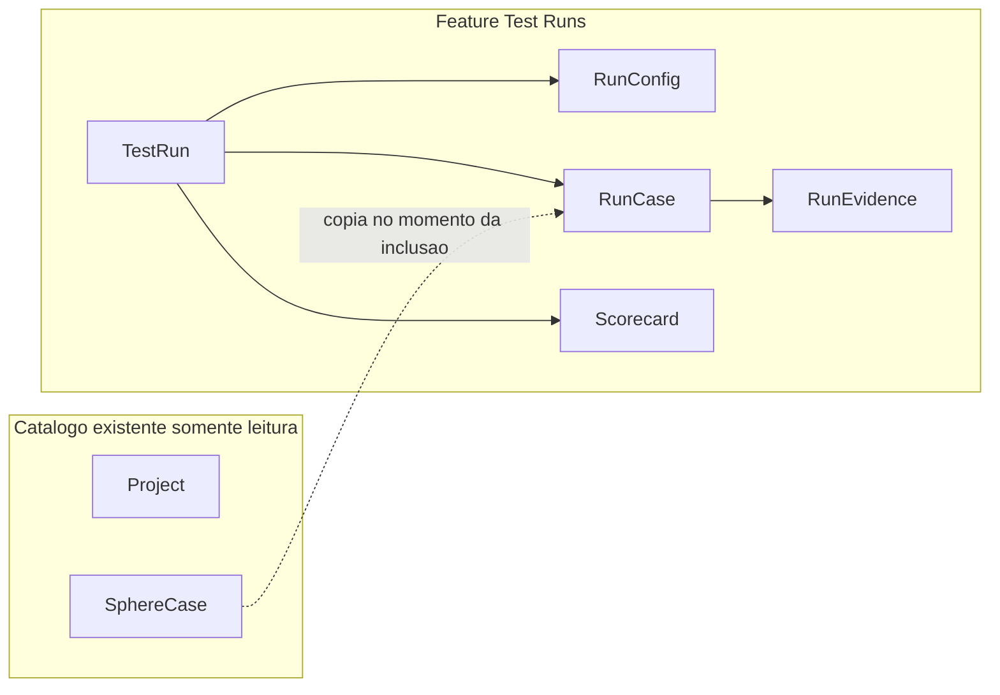

# Especificação: Test Runs e Scorecard de Execução

**Projeto:** Centro de Execução QA TMS  
**Módulo:** Test Runs, feature nova e isolada  
**Versão:** 1.1.0  
**Data:** 8 de novembro de 2026  
**Status:** Especificação revisada — isolamento em relação às features existentes  
**Referência de mercado:** [QA Sphere — Test Runs Scorecard](https://qasphere.com/docs/reports/run-scorecard-report/)

Este documento descreve o módulo. A implementação de código, schema Prisma, rotas e testes fica para uma etapa posterior, depois de nova aprovação.

---

## 1. Objetivo

Test Runs é uma **feature nova**. Ela não altera TMS, execução manual, evidências do caso, Terminal, Robot, Reports, PDF, Excel do catálogo, navegador SQLite nem autenticação.

O operador abre o módulo, escolhe casos **já cadastrados** e executa esse ciclo ali dentro: informa versão, plataforma e os demais critérios, marca o resultado de cada caso e compara ciclos no scorecard. O resultado fica só nas tabelas do Test Run. A lista do TMS, o último status do caso e o histórico de execução Robot permanecem como estavam.

O desenho de produto segue **QA Sphere + TestRail** no que é ciclo, configuração e scorecard. A implementação não reutiliza o motor Robot nem as evidências do caso.

---

## 2. Princípio de isolamento

Há um único contato com o que já existe: **leitura** do catálogo no momento de montar o escopo. Incluir um caso copia identificador, pasta, título e badge para o ciclo. Depois disso, o run não consulta de novo essas colunas para exibir ou calcular o scorecard.



### 2.1 O módulo grava apenas nestas tabelas novas

- `test_runs`
- `test_run_cases`
- `test_run_events`
- `test_run_evidence`

Nenhuma coluna nova em `Execution`, `TestCase`, `Step`, `TestCaseSphere`, `SphereManualExecution`, `TestCaseEvidence`, `Project`, `User` ou nas demais tabelas atuais. Os modelos Prisma existentes não recebem relação de volta. `projectId`, `sourceTestCaseId` e `userId` são strings opacas, sem `@relation` para não editar o model alheio.

### 2.2 O que a feature não faz

- Não atualiza `lastExecutionStatus`, `lastExecutionMode` nem `lastExecutedAt`.
- Não cria linha em `SphereManualExecution`.
- Não grava em `TestCaseEvidence` e não chama `/api/test-cases-sphere/:id/evidence`.
- Não cria, não altera e não lê `Execution` para sugerir status. Não há ação "Vincular execução Robot".
- Não dispara `POST /api/terminal/run` e não muda comando, tag, parser ou os botões singular e plural.
- Não adiciona rota, filtro, botão ou coluna em `/reports`. O PDF de execução Robot continua com as regras atuais.
- Não altera `/tms`, `/terminal` nem `/sqlite`.

### 2.3 Únicos encaixes no aplicativo

Para a feature ser acessível, e só para isso:

| Ponto | O que entra | O que não muda |
|---|---|---|
| Menu | Um item novo **Test Runs** apontando para `/test-runs` | Nenhum item, rótulo ou destino dos menus atuais |
| Rotas | Página `/test-runs` e `/test-runs/scorecard` | Redirecionamentos de `/`, `/reports`, `/tms`, `/terminal`, `/sqlite` |
| i18n | Chaves novas do módulo | Textos já existentes |
| Schema | Models novos no final de `schema.prisma` | Models já declarados |
| Sessão | Leitura do usuário e do papel já autenticados | Regras de login, bloqueio e papéis nas telas antigas |

Arquivos de TMS, Terminal, Reports, execução manual, evidência, Robot e exportadores atuais não entram no diff da feature. Exportação XLSX e PDF do scorecard nascem em arquivos novos do módulo.

---

## 3. Contexto que motiva a feature

O sistema já cobre cadastro e execução, cada um no próprio lugar. Nenhum deles é estendido.

| Feature atual | O que continua fazendo | Por que não serve de ciclo |
|---|---|---|
| Casos TMS (`TestCaseSphere`) | Cadastro, pasta, critérios de aceite | O último status é do caso, não de uma versão/plataforma |
| Execução manual (`SphereManualExecution`) | Resultado avulso no caso | Não agrupa versão, ambiente, browser nem milestone |
| Robot (`Execution`, `TestCase`, `Step`) | Corrida real, `output.xml`, Reports e PDF | Não é um ciclo nomeado sobre o catálogo do TMS |
| Projeto | Agrupa pastas; `platform` descreve o produto | Não descreve a execução |

O Test Run existe para o buraco entre essas features, sem fundir os dados delas.

---

## 4. Soluções de mercado

O scorecard da QA Sphere é a referência de relatório. As outras ferramentas confirmam que versão, plataforma e milestone pertencem ao ciclo.

| Produto | O que aproveitar | Link |
|---|---|---|
| **QA Sphere** | Scorecard com Passed, Failed, Open, Blocked e Skipped; seleção por milestone, test run ou período; exportação XLSX, PDF e impressão; nomes com sprint, browser e tipo de suíte | [Run Scorecard](https://qasphere.com/docs/reports/run-scorecard-report/) |
| **TestRail** | Test run, milestone, configuração (browser, sistema) e vários resultados do mesmo caso | [TestRail](https://www.testrail.com/) |
| **Zephyr Scale** | Ciclo ligado a versão e sprint | [Zephyr Scale](https://smartbear.com/test-management/zephyr/) |
| **Xray** | Test execution com versão e ambiente | [Xray](https://www.getxray.app/) |
| **Azure Test Plans** | Test run com configuração e build | [Azure Test Plans](https://learn.microsoft.com/azure/devops/test/overview) |
| **qTest** | Ciclos e leitura de prontidão de release | [qTest](https://www.tricentis.com/) |
| **PractiTest** | Instâncias de teste por ciclo | [PractiTest](https://www.practitest.com/) |
| **Allure TestOps** | Launch com ambiente e tendência, no mundo da automação | [Allure TestOps](https://qameta.io/) |
| **Testmo** | Runs com milestone e configuração, sem substituir o catálogo | [Testmo](https://www.testmo.com/) |

Allure TestOps se aproxima do Reports que o TMS já tem. O Test Run não copia esse Reports. O relatório novo é só o scorecard dos ciclos criados neste módulo.

### 4.1 Leitura do scorecard que este módulo reproduz

1. **Agregado** no topo: percentuais e contagens de Passed, Failed, Open, Blocked e Skipped somando os runs selecionados. Se o mesmo caso passou num run e falhou noutro, os dois resultados entram na soma.
2. **Tabela** por run: Name, Total, Open, Passed, Failed, Skipped, Blocked, no formato `75% (18)`.
3. **Filtro** por milestone, por test runs escolhidos ou por período.
4. **Exportação** XLSX e PDF. Impressão do navegador cobre o papel da opção Print da QA Sphere.
5. **Comparação** com escopos ou versões diferentes é permitida, com aviso de que os totais não são equivalentes.
6. **Nome legível** sugerido: `Sprint 24 - Chrome - Regressão Login`.

Texto de ajuda do scorecard, sem decisão automática de go/no-go:

- Paridade de browser: taxas de aprovação próximas, na ordem de 5 pontos percentuais.
- Paridade de ambiente: homologação e produção no mesmo escopo e na mesma versão.
- Tendência de sprint: regressões sucessivas com a mesma suíte.
- Cobertura: Open acima de zero significa ciclo incompleto.

---

## 5. Configuração do Test Run

| Campo | Obrigatório | Regra |
|---|---|---|
| Nome | Sim | 3 a 160 caracteres. Sugestão: `{milestone} - {browser ou plataforma} - {tipo de suíte}` |
| Projeto | Sim | Id de um `Project` existente, usado só para filtrar o catálogo na inclusão. O valor fica copiado no run |
| Versão da aplicação | Sim | Versão sob teste, digitada pelo operador. Não vem do git do TMS |
| Plataforma | Sim | `Web`, `Mobile` ou `Desktop`, escolhida no run. Não é lida de `Project.platform` |
| Ambiente | Sim | `Local`, `Dev`, `Homologação`, `Produção` |
| Browser ou dispositivo | Condicional | Obrigatório em `Web` e `Mobile`. Opcional em `Desktop`. Até 60 caracteres |
| Milestone | Sim | 2 a 80 caracteres. Exemplos: `Sprint 24`, `Release 2.5` |
| Tipo de suíte | Sim | `Smoke`, `Regressão`, `Feature`, `Sanidade` |
| Modo | Sim | `Manual`, `Automatizado` ou `Misto`. É rótulo do ciclo. Não liga o Terminal |
| Executor responsável | Sim | Id do usuário autenticado que cria o run |
| Início planejado | Não | Se vazio, o início efetivo é a passagem para `In Progress` |
| Escopo | Sim, para sair de rascunho | Um ou mais casos do projeto. Lista vazia só em `Draft` |

### 5.1 Versão

Formatos aceitos: `2.5.0`, `2.5.0-rc.1`, `2.5.0+build.1842`, `2.5.0-rc.1+build.1842`.

```text
^(0|[1-9]\d*)\.(0|[1-9]\d*)\.(0|[1-9]\d*)(?:-[0-9A-Za-z.-]+)?(?:\+[0-9A-Za-z.-]+)?$
```

Rejeitar vazio, `latest`, `v2.5`, `2.5` e texto com espaço. A mensagem cita o exemplo `2.5.0` ou `2.5.0+build.1842`.

Com algum caso diferente de Open, só `admin` altera a versão. O evento `VERSION_CHANGED` guarda o valor anterior e o novo.

### 5.2 Plataforma, ambiente e browser

A plataforma do run é independente da plataforma cadastrada no projeto. O formulário não preenche esse campo sozinho.

Sugestões de browser na UI, com texto livre para dispositivo:

- Web: `Chrome`, `Firefox`, `Edge`, `Safari`
- Mobile: `Android Chrome`, `iOS Safari`, `Pixel 8`, `iPhone 15`
- Desktop: vazio, ou `Windows 11`, `macOS`

`Web` ou `Mobile` sem browser/dispositivo responde `400`.

### 5.3 Status do ciclo

| Status | Significado | Quem move |
|---|---|---|
| `Draft` | Configuração incompleta ou sem casos | Criador, `analyst`, `admin` |
| `In Progress` | Casos podem receber resultado | Criador ao iniciar, ou o primeiro resultado |
| `Completed` | Ciclo encerrado | `analyst` ou `admin` |
| `Aborted` | Ciclo descartado; fora do scorecard salvo filtro explícito | `analyst` ou `admin` |

Transições: `Draft` → `In Progress` (exige ao menos um caso); `In Progress` → `Completed` ou `Aborted`; volta para `In Progress` só com `admin`.

`Completed` e `Aborted` não aceitam resultado nem caso novo até a reabertura.

---

## 6. Modelo de dados

Campos `String` validados com Zod, no mesmo estilo de `platform` e `role`. Sem enums Prisma novos. Sem relação com models existentes.

Na inclusão, o serviço lê o caso no catálogo e grava a cópia. Renomear ou apagar o caso no TMS depois não altera a linha do run e não é alterado por ela.

```prisma
model TestRun {
  id               String            @id
  projectId        String            @map("project_id")
  projectName      String            @map("project_name")
  name             String
  appVersion       String            @map("app_version")
  platform         String
  environment      String
  browserOrDevice  String?           @map("browser_or_device")
  milestone        String
  suiteType        String            @map("suite_type")
  mode             String
  status           String            @default("Draft")
  plannedStartAt   String?           @map("planned_start_at")
  startedAt        String?           @map("started_at")
  closedAt         String?           @map("closed_at")
  createdByUserId  String            @map("created_by_user_id")
  createdAt        String            @map("created_at")
  updatedAt        String            @map("updated_at")
  cases            TestRunCase[]
  events           TestRunEvent[]

  @@index([projectId])
  @@index([milestone])
  @@index([status])
  @@map("test_runs")
}

model TestRunCase {
  id                 String            @id
  testRunId          String            @map("test_run_id")
  sourceTestCaseId   String            @map("source_test_case_id")
  folderSnapshot     String            @map("folder_snapshot")
  titleSnapshot      String            @map("title_snapshot")
  badgeSnapshot      String            @map("badge_snapshot")
  status             String            @default("Open")
  notes              String            @default("")
  durationS          Float?            @map("duration_s")
  executedByUserId   String?           @map("executed_by_user_id")
  executedAt         String?           @map("executed_at")
  testRun            TestRun           @relation(fields: [testRunId], references: [id], onDelete: Cascade)
  evidence           TestRunEvidence[]

  @@unique([testRunId, sourceTestCaseId])
  @@index([testRunId])
  @@map("test_run_cases")
}

model TestRunEvent {
  id          String  @id
  testRunId   String  @map("test_run_id")
  userId      String  @map("user_id")
  action      String
  summary     String  @default("")
  time        String
  testRun     TestRun @relation(fields: [testRunId], references: [id], onDelete: Cascade)

  @@index([testRunId])
  @@map("test_run_events")
}

model TestRunEvidence {
  id           String      @id
  testRunCaseId String     @map("test_run_case_id")
  evidenceType String      @map("evidence_type")
  title        String      @default("")
  mimeType     String?     @map("mime_type")
  fileName     String?     @map("file_name")
  imageData    Bytes?      @map("image_data")
  storagePath  String?     @map("storage_path")
  externalUrl  String?     @map("external_url")
  createdAt    String      @map("created_at")
  createdBy    String      @map("created_by")
  testRunCase  TestRunCase @relation(fields: [testRunCaseId], references: [id], onDelete: Cascade)

  @@index([testRunCaseId])
  @@map("test_run_evidence")
}
```

`TestRunEvent.action`: `RUN_CREATED`, `RUN_STARTED`, `RUN_COMPLETED`, `RUN_ABORTED`, `RUN_REOPENED`, `CASES_ADDED`, `CASE_REMOVED`, `RESULT_RECORDED`, `VERSION_CHANGED`, `EVIDENCE_ADDED`.

Status do caso no run: `Open`, `Passed`, `Failed`, `Blocked`, `Skipped`. Esse vocabulário não é traduzido para `PASS` / `FAIL` / `BLOCKED` / `SKIP` e não é escrito no caso TMS.

Evidência do run: `file` (imagem) ou `link` (URL e título opcional), nos endpoints do próprio módulo. Arquivo de vídeo, se entrar na implementação, usa pasta própria sob `results/test-runs/`, sem misturar com `results/<RUN-...>` do Robot.

---

## 7. Features do módulo

Tudo abaixo vive em páginas, componentes, services, repositórios e rotas novos.

### 7.1 Cadastro

Formulário PT/EN com a seção 5. O nome sugerido preenche o campo somente enquanto o operador não o editou.

Zod no Route Handler. Erro de campo volta `400` com a chave do campo. Rascunho pode nascer sem casos. Iniciar sem casos retorna `400`.

### 7.2 Seleção de casos

A tela do run tem o próprio seletor. Ela não adiciona botão na lista do TMS.

Origens, todas lidas na hora e copiadas:

- Casos de uma pasta/feature do projeto escolhido.
- Casos marcados no seletor.
- Várias pastas do mesmo projeto.

Regras:

- Caso cujo `folder` não pertence ao projeto do run é rejeitado.
- Caso já copiado no run entra em `skippedDuplicates` e não gera segunda linha.
- Remover só em `Draft` ou `In Progress`, e só com status `Open`.
- A resposta de inclusão não devolve escrita no catálogo. Um teste de isolamento confere que `lastExecutionStatus` do caso fonte permanece igual.

O badge exibido no run é `badgeSnapshot`, calculado na cópia com a mesma regra visual já usada no TMS (tag do cenário ou id normalizado, sem nome da pasta). O cálculo ocorre no service novo, sobre os campos lidos, sem alterar o componente de card do TMS.

### 7.3 Registro do resultado

Cada linha mostra badge, título copiado e status.

Registrar resultado exige:

- status `Passed`, `Failed`, `Blocked` ou `Skipped`;
- notas até 4000 caracteres;
- duração opcional entre 0 e 86400 segundos;
- nota com pelo menos 10 caracteres em `Failed` e `Blocked`;
- run `In Progress`. O primeiro resultado de um `Draft` que já tem casos promove o run e grava `startedAt`.

Evidência é opcional e exclusiva do `TestRunCase`: arquivo de imagem ou link, com ação explícita de salvar o link.

O modo `Automatizado` ou `Misto` só classifica o ciclo no scorecard. O operador registra o resultado na própria tela. O módulo não executa Robot e não importa `output.xml`.

### 7.4 Scorecard

Rota `/test-runs/scorecard`, dentro do módulo. Não é aba nem subrota de `/reports`.

Filtros: milestone, um ou mais runs, ou período (`startedAt` ou `closedAt`). Pelo menos um critério. Lista vazia: estado vazio e exportação inativa.

Agregado soma as contagens dos runs selecionados. Percentual = `contagem / total * 100`, uma casa decimal, half away from zero. Total = quantidade de `TestRunCase`. Open + Passed + Failed + Skipped + Blocked = Total.

| Coluna | Conteúdo |
|---|---|
| Name | Nome do run; abaixo, versão, plataforma, ambiente e browser |
| Total | Casos do run |
| Open, Passed, Failed, Skipped, Blocked | Percentual e contagem |

Avisos não bloqueantes: conjuntos de `sourceTestCaseId` diferentes, versões diferentes, run `Aborted` incluído de propósito. Abortados ficam de fora por padrão.

Exportação em código novo:

- **XLSX**: aba de agregado e aba de linhas (run, caso, status, versão, plataforma, ambiente, browser, milestone).
- **PDF**: agregado e tabela, iguais à tela. Sem screenshots do Robot.

### 7.5 Governança

Papéis lidos da sessão atual. A matriz abaixo vale só para as rotas deste módulo.

| Ação | tester | analyst | admin |
|---|---|---|---|
| Criar run e incluir casos | Sim | Sim | Sim |
| Registrar resultado e evidência | Sim | Sim | Sim |
| Encerrar ou abortar | Não | Sim | Sim |
| Reabrir | Não | Não | Sim |
| Alterar versão com resultado já preenchido | Não | Não | Sim |
| Exportar scorecard | Não | Sim | Sim |
| Ver scorecard | Sim | Sim | Sim |

Sem sessão: `401`. Papel insuficiente: `403`. Mudança de resultado e de status grava `TestRunEvent`.

---

## 8. Critérios de aceitação

### 8.1 Versão

- **AC-VER-01** — Versão `2.5.0` aparece no detalhe do run e na coluna Name do scorecard.
- **AC-VER-02** — `2.5.0-rc.1` e `2.5.0+build.1842` são aceitas.
- **AC-VER-03** — Vazio, `latest`, `v2.5` e `2.5` respondem `400`.
- **AC-VER-04** — Com caso diferente de Open, `tester` não altera a versão; `admin` altera e `VERSION_CHANGED` guarda os dois valores.

### 8.2 Plataforma e configuração

- **AC-PLT-01** — Plataforma aceita somente `Web`, `Mobile` e `Desktop`.
- **AC-PLT-02** — Ambiente aceita somente `Local`, `Dev`, `Homologação` e `Produção`.
- **AC-PLT-03** — `Web` ou `Mobile` sem browser/dispositivo é rejeitado.
- **AC-PLT-04** — `Desktop` sem browser/dispositivo é aceito.
- **AC-PLT-05** — O formulário deixa plataforma vazia até o operador escolher, mesmo que o projeto tenha `platform` preenchida.
- **AC-CFG-01** — Milestone vazio ou com um caractere é rejeitado.
- **AC-CFG-02** — Nome sugerido `Sprint 24 - Chrome - Regressão Login` enquanto o operador não editou o nome.
- **AC-CFG-03** — Nome editado não é sobrescrito quando o browser muda.

### 8.3 Escopo

- **AC-ESC-01** — Incluir uma pasta copia todos os casos daquela pasta no projeto.
- **AC-ESC-02** — O mesmo `sourceTestCaseId` no mesmo run não duplica. A resposta lista a duplicata ignorada.
- **AC-ESC-03** — Caso de outro projeto responde `400` e não cria linha.
- **AC-ESC-04** — A cópia nasce `Open`. `lastExecutionStatus` do caso fonte permanece o mesmo de antes da inclusão.
- **AC-ESC-05** — `Draft` sem casos não vai para `In Progress`.
- **AC-ESC-06** — Título, pasta e badge exibidos no run vêm do snapshot. Alterar o título no TMS depois da inclusão não muda a linha do run.

### 8.4 Resultados e evidência

- **AC-RES-01** — Passed, Failed, Blocked ou Skipped grava executor, instante e a duração quando informada.
- **AC-RES-02** — Failed ou Blocked sem nota de pelo menos 10 caracteres é rejeitado.
- **AC-RES-03** — O primeiro resultado em um `Draft` com casos muda o run para `In Progress` e preenche `startedAt`.
- **AC-RES-04** — `Completed` ou `Aborted` rejeita resultado até reabertura por `admin`.
- **AC-RES-05** — Gravar resultado não escreve em `test_cases_sphere`, `sphere_manual_executions` nem `test_case_evidence`.
- **AC-RES-06** — O mesmo caso fonte pode estar Passed num run Chrome e Failed num run Safari.
- **AC-RES-07** — Imagem ou link de evidência grava em `test_run_evidence` e não aparece na aba Evidências do caso no TMS.
- **AC-RES-08** — Nenhuma rota do módulo aceita `executionId` nem dispara execução Robot.

### 8.5 Scorecard

- **AC-SCR-01** — Dois runs geram duas linhas, com percentual e contagem, por exemplo `75% (18)`.
- **AC-SCR-02** — O agregado soma os runs. Passed num run e Failed no outro incrementam os dois status no agregado.
- **AC-SCR-03** — A soma dos cinco status fecha o total em cada linha e no agregado.
- **AC-SCR-04** — Filtro por milestone, ids ou período devolve só os runs que casam. `Aborted` fica de fora salvo inclusão explícita.
- **AC-SCR-05** — Filtro sem runs mostra estado vazio e desabilita XLSX e PDF.
- **AC-SCR-06** — XLSX tem uma linha por caso de cada run, com versão, plataforma, ambiente e browser.
- **AC-SCR-07** — PDF mostra o agregado e a tabela da tela.
- **AC-SCR-08** — Versões ou conjuntos de casos diferentes exibem aviso e o relatório ainda é gerado.
- **AC-SCR-09** — A página do scorecard é `/test-runs/scorecard`. `/reports` não ganha link, query nem seção deste relatório.

### 8.6 Acesso, idioma e isolamento de tela

- **AC-RBAC-01** — Sem sessão, criar run ou registrar resultado responde `401`.
- **AC-RBAC-02** — `tester` recebe `403` ao encerrar, abortar, reabrir, alterar versão com resultados ou exportar.
- **AC-RBAC-03** — `analyst` encerra, aborta e exporta, e recebe `403` ao reabrir.
- **AC-RBAC-04** — Strings novas usam `t('PT', 'EN')`. Chaves antigas permanecem com o mesmo texto.
- **AC-ISO-01** — `/tms`, `/terminal`, `/reports` e `/sqlite` não exibem controle de Test Run. O item novo de menu só navega para `/test-runs`.
- **AC-ISO-02** — Specs E2E já existentes de TMS, Terminal e PDF não são editados e seguem verdes.

---

## 9. API

Namespace exclusivo `/api/test-runs`. Zod, service e repositório novos. Nenhuma rota em `app/api/terminal`, `app/api/executions`, `app/api/test-cases-sphere` ou `app/api/folders` é editada.

| Método | Rota | Uso |
|---|---|---|
| `POST` | `/api/test-runs` | Cria rascunho |
| `GET` | `/api/test-runs` | Lista por projeto, milestone ou status |
| `GET` | `/api/test-runs/:id` | Detalhe com casos, eventos e evidências |
| `PATCH` | `/api/test-runs/:id` | Atualiza configuração ainda editável |
| `POST` | `/api/test-runs/:id/cases` | Copia casos (`sourceTestCaseIds` ou `folderPath`) |
| `DELETE` | `/api/test-runs/:id/cases/:sourceTestCaseId` | Remove caso Open |
| `POST` | `/api/test-runs/:id/cases/:sourceTestCaseId/result` | Grava resultado |
| `POST` | `/api/test-runs/:id/cases/:sourceTestCaseId/evidence` | Imagem ou link do run |
| `POST` | `/api/test-runs/:id/start` | `Draft` → `In Progress` |
| `POST` | `/api/test-runs/:id/complete` | Encerra |
| `POST` | `/api/test-runs/:id/abort` | Aborta |
| `POST` | `/api/test-runs/:id/reopen` | Admin reabre |
| `GET` | `/api/test-runs/scorecard` | Query `milestone`, `runIds`, `from`, `to`, `includeAborted` |
| `GET` | `/api/test-runs/scorecard/export` | `format=xlsx` ou `format=pdf` e os mesmos filtros |

`GET /api/test-runs/scorecard` sem milestone, sem `runIds` e sem período responde `400`.

A inclusão de casos é o único handler que lê `Project`, `FolderProject` e `TestCaseSphere`. O handler de resultado escreve só `test_run_cases` e `test_run_events`.

---

## 10. Testes

Vitest e React Testing Library entram com a feature, em arquivos novos. Playwright ganha specs novos. Specs atuais não são modificados para “abrir espaço” ao módulo.

### 10.1 Unitário

`src/server/services/testRunScorecard.test.ts` e `src/server/validation/testRunSchemas.test.ts`. Funções puras, sem Prisma e sem os services de TMS ou Robot.

| Teste | Critério |
|---|---|
| `aggregateScorecard conta Passed e Failed do mesmo caso em runs diferentes` | AC-SCR-02 |
| `percentual de 18 em 24 é 75.0 e a soma dos status fecha o total` | AC-SCR-01, AC-SCR-03 |
| `run abortado sai do scorecard quando includeAborted é falso` | AC-SCR-04 |
| `aceita versão 2.5.0, 2.5.0-rc.1 e 2.5.0+build.1842` | AC-VER-02 |
| `rejeita versão latest e v2.5` | AC-VER-03 |
| `sugere o nome Sprint 24 - Chrome - Regressão Login` | AC-CFG-02 |
| `não sobrescreve nome já editado pelo operador` | AC-CFG-03 |
| `Web sem browser é inválido e Desktop sem browser é válido` | AC-PLT-03, AC-PLT-04 |
| `Draft sem casos não inicia` | AC-ESC-05 |
| `primeiro resultado promove Draft a In Progress` | AC-RES-03 |
| `Completed rejeita resultado e admin reaberto volta a aceitar` | AC-RES-04 |
| `Failed sem nota de 10 caracteres é inválido` | AC-RES-02 |
| `inclusão ignora caso duplicado e rejeita caso de outro projeto` | AC-ESC-02, AC-ESC-03 |
| `snapshot de título não acompanha rename posterior do catálogo` | AC-ESC-06 |

Tabela que o teste do agregado fixa:

| Run | Total | Open | Passed | Failed | Skipped | Blocked |
|---|---:|---:|---:|---:|---:|---:|
| UI Testing (Safari) | 24 | 0 | 18 | 3 | 1 | 2 |
| Functional Testing (Chrome) | 26 | 6 | 12 | 4 | 1 | 3 |
| Agregado | 50 | 6 | 30 | 7 | 2 | 5 |

1/24 com uma casa, half away from zero, é `4.2% (1)`. 12/26 é `46.2% (12)`. O teste trava esses valores.

### 10.2 Componente

Arquivos em `src/components/testRuns/`, sem importar `TmsView`, `ExecutionReports` ou `LiveTerminal`.

| Teste | Critério |
|---|---|
| `TestRunForm exibe erro em versão latest e em Web sem browser` | AC-VER-03, AC-PLT-03 |
| `TestRunForm sugere o nome e preserva edição manual` | AC-CFG-02, AC-CFG-03 |
| `TestRunForm não preenche plataforma a partir do projeto` | AC-PLT-05 |
| `ScorecardTable renderiza 75% (18) e 46.2% (12)` | AC-SCR-01 |
| `ScorecardTable mostra aviso quando as versões diferem` | AC-SCR-08 |
| `ScorecardEmptyState desabilita exportação` | AC-SCR-05 |

### 10.3 End-to-end

Page objects novos. Os fluxos não clicam em Executar Teste Automatizado, Executar Testes, Executar Feature nem no PDF de `/reports`.

**`e2e/test-runs.spec.ts`**

1. Autenticar como tester.
2. Abrir `/test-runs` pelo item novo de menu.
3. Criar run com versão `2.5.0`, plataforma `Web`, ambiente `Homologação`, browser `Chrome`, milestone `Sprint 24`, suíte `Regressão`.
4. Incluir os casos de uma feature pelo seletor do próprio módulo.
5. Marcar um caso Passed, outro Failed com nota, outro Blocked com nota, e anexar um link de evidência.
6. Abrir o caso correspondente no TMS e conferir que o último status e a lista de evidências do caso não mudaram (AC-RES-05, AC-RES-07).
7. Abrir `/test-runs/scorecard`, filtrar o run e conferir os totais. Exportação indisponível para o tester (AC-RBAC-02).

**`e2e/test-runs-scorecard.spec.ts`**

1. Autenticar como analyst.
2. Criar dois runs do mesmo conjunto, `Chrome` e `Firefox`, mesma versão e mesmo milestone, só pelas telas `/test-runs`.
3. Registrar Passed em todos no Chrome e Failed em um caso no Firefox.
4. Gerar o scorecard e conferir o agregado (AC-SCR-02).
5. Exportar XLSX e PDF com corpo não vazio (AC-SCR-06, AC-SCR-07).
6. Abrir o scorecard sem filtro e verificar que a exportação não dispara (AC-SCR-05).
7. Abrir `/reports` e verificar que a página não oferece scorecard de Test Runs (AC-SCR-09).

**Isolamento da suíte antiga**

- `e2e/tms.spec.ts`, `e2e/terminal.spec.ts`, `e2e/reports-pdf.spec.ts` e os demais specs atuais permanecem sem edição (AC-ISO-02).

### 10.4 Fora desta suíte

- Decisão humana de go/no-go.
- Qualquer execução Robot. O modo automatizado do run não tem spec de Terminal.

---

## 11. Interface

- Lista, detalhe, seletor de casos, resultado e evidência em `/test-runs`.
- Scorecard em `/test-runs/scorecard`, com navegação interna do módulo.
- Bordas de botão no padrão do shell: repouso claro, hover mais forte, só tons Tailwind da escala oficial.
- Rótulos de status na UI: Não Iniciado, Aprovado, Falhou, Bloqueado, Ignorado. A string `Open` não aparece para o operador.
- O header continua com um único indicador `DB: CONECTADO` / `DB: CONNECTED`.
- Visual próprio do módulo, alinhado ao tema escuro e ao acento `#FF6600`, sem embutir componentes de Reports.

---

## 12. Fases de implementação

Cada fase só começa com pedido explícito. Nenhuma fase edita feature existente.

1. **Cadastro e cópia de casos** — models novos, Zod, rotas de run e de inclusão, AC-VER, AC-PLT, AC-CFG, AC-ESC, unitários.
2. **Resultado, evidência e papéis** — AC-RES, AC-RBAC, AC-ISO-01 no que for tela.
3. **Scorecard, XLSX e PDF** — `/test-runs/scorecard`, AC-SCR, componente e os dois E2E.
4. **Vitest** — junto da fase 1, só para os arquivos novos.

Não há fase de vínculo com Robot nem fase de atualização do atalho do caso TMS.

---

## 13. Fora de escopo

- Qualquer mudança de comportamento, layout ou persistência em TMS, execução manual, evidências do caso, Terminal, Robot, Reports, PDF de execução, Excel do catálogo, SQLite browser e autenticação.
- Disparar ou importar execução Robot a partir do Test Run.
- Escrever o resultado do ciclo de volta no caso cadastrado.
- Sincronizar versão com git, CI ou arquivo de build.
- Matriz automática de configurações (test plan). Chrome e Firefox são dois runs criados no módulo.
- Bloqueio automático de release por taxa de falha.
- Traduzir o texto dos casos. Só a interface do módulo é bilíngue.


Referências de QA Sphere, TestRail, Zephyr, Xray, Azure Test Plans, qTest, PractiTest, Allure TestOps e Testmo.
