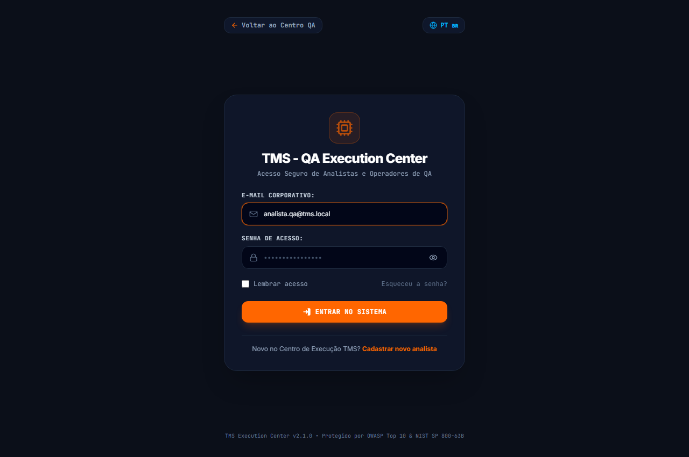
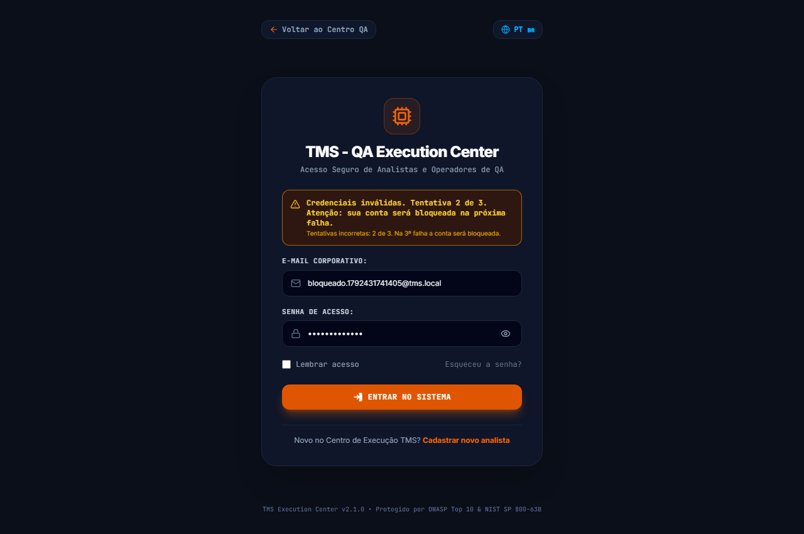
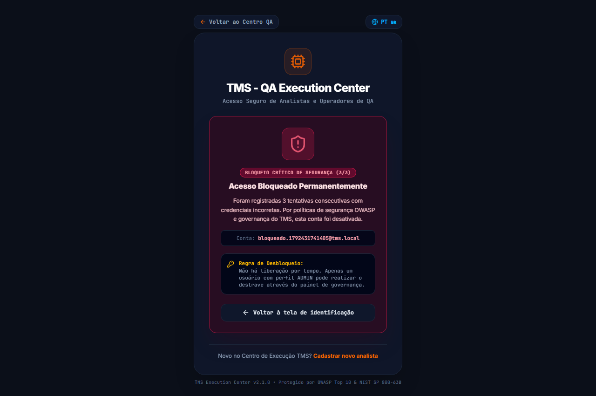
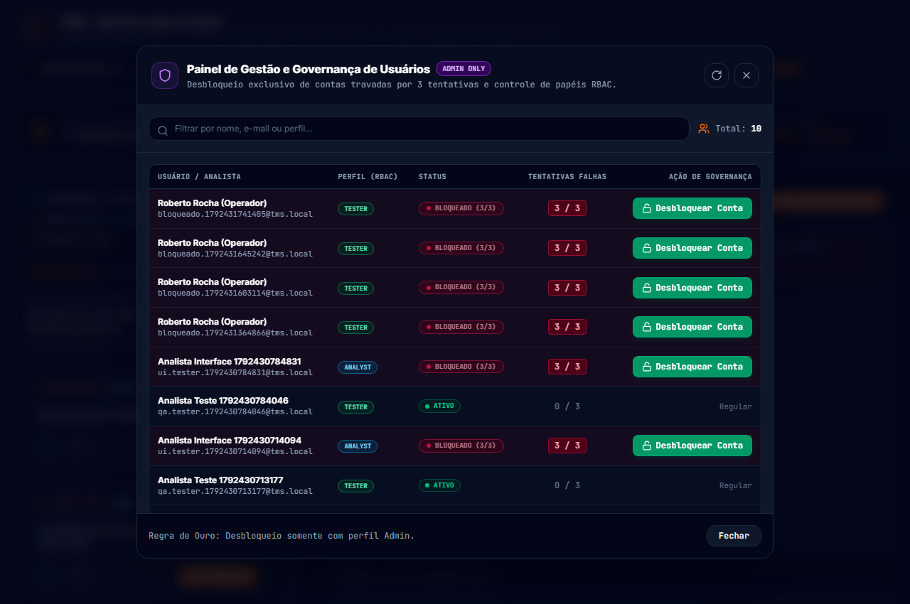
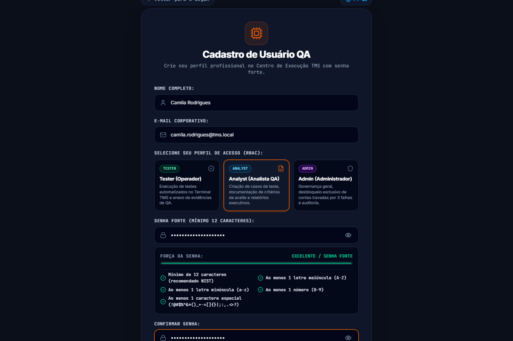
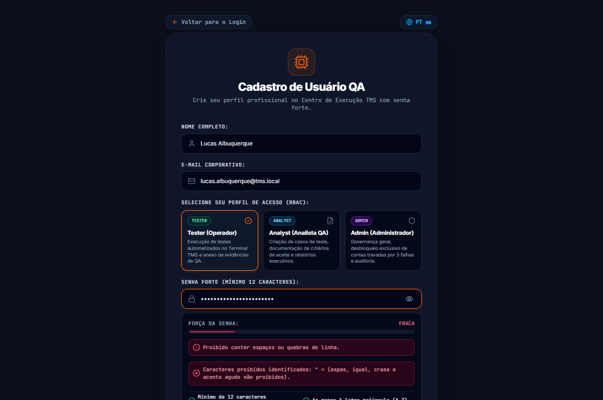
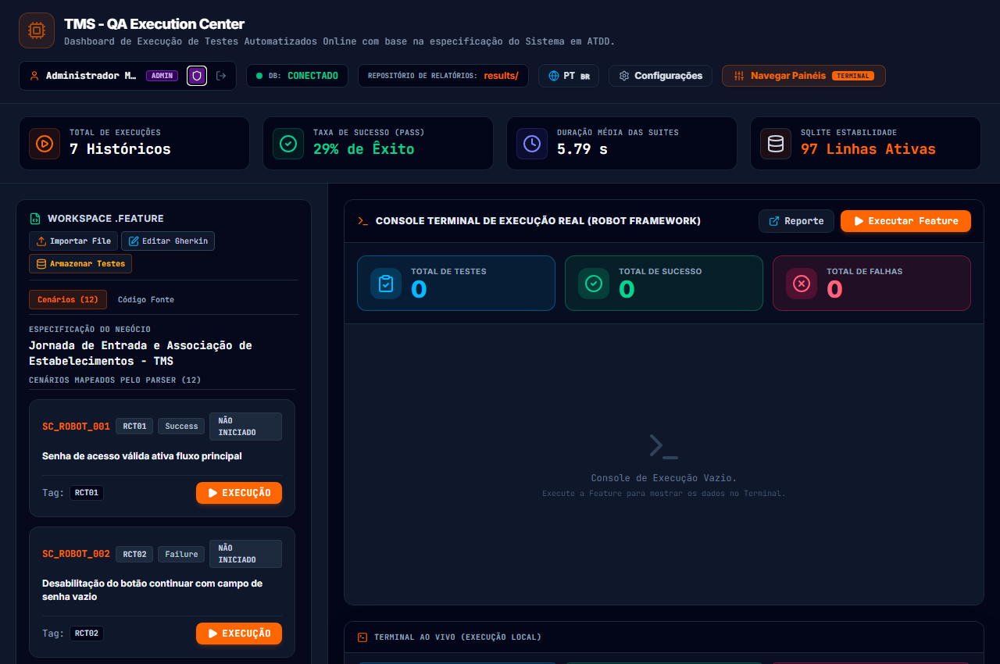

# 📋 Release Notes — Módulo de Autenticação, Cadastro e Governança de Usuários (v2.1.0)

**Centro de Execução QA TMS**  
**Versão:** `v2.1.0-auth-security`  
**Data:** 19 de Outubro de 2026  
**Status:** Planejado & Especificado (Pronto para Implementação)  
**Classificação:** Segurança Crítica / Governança de Acesso e RBAC  

---

## 🎯 1. Sumário Executivo

A release **v2.1.0** introduz o ecossistema completo de **Autenticação, Cadastro de Usuários, Controle de Acesso Baseado em Papéis (RBAC)** e **Bloqueio Crítico de Contas** no **Centro de Execução QA TMS**.

Até a versão v2.0, a aplicação operava prioritariamente em modo sandbox local, expondo rotas e consoles (Terminal, Navegador SQLite, TMS e Relatórios) sem autenticação prévia obrigatória. Com a integração deste módulo, a plataforma adota o padrão de segurança corporativo em conformidade com as diretrizes **OWASP Top 10** e os padrões de senhas do **NIST SP 800-63B**, garantindo:
- **Perfis de Usuário Especializados**: `admin`, `analyst` e `tester`.
- **Política de Senha Forte**: 12+ caracteres, entropia calculada em tempo real e verificação anti-dicionário.
- **Regra Rígida de Bloqueio**: Exatamente **3 tentativas de erro** bloqueiam a conta.
- **Desbloqueio Exclusivo por Administrador**: Proibido desbloqueio automático por tempo; somente um usuário com perfil `admin` pode destravar a conta.

---

## 👥 2. Matriz de Perfis (RBAC)

| Perfil | Escopo e Responsabilidades |
|---|---|
| **`admin`** | Administrador geral da plataforma. Possui privilégios totais, incluindo gestão de usuários, **desbloqueio exclusivo de contas travadas por 3 falhas**, alteração de perfis, auditoria de segurança, parametrização do Robot e reset do banco relacional. |
| **`analyst`** | Analista de QA / Negócios. Responsável pela criação e manutenção de casos de teste, documentação de critérios de aceite, relatórios executivos (Excel/PDF) e monitoramento de qualidade. Não possui permissão para desbloquear contas. |
| **`tester`** | Operador de Testes. Focado na execução manual e automatizada no Terminal TMS, apontamento de resultados (PASS/FAIL/SKIP) e anexo de evidências. Não pode alterar critérios de aceite nem desbloquear usuários. |

---

## 🚀 3. Novas Funcionalidades (New Features)

### 3.1. Tela de Login Corporativa (`/login`)
- **Interface de Alta Fidelidade**: Desenvolvida com a paleta nativa do TMS (Dark theme em `#0b0f19`, cartões em `#121826`, acentos em laranja `#FF6600` e bordas dinâmicas em conformidade com o design system do projeto).
- **Entrada Segura**:
  - Campos tipados e validados para E-mail corporativo e Senha de acesso.
  - Alternância visual de visibilidade de senha (ícone de olho com suporte a acessibilidade e labels dinâmicos via `lucide-react`).
  - Opção "Lembrar meu acesso" configurando persistência segura de sessão respeitando tempo limite do token.
  - Link direto para solicitação de cadastro para novos operadores.
- **Prevenção de Enumeração de Contas**:
  - Mensagens de erro seguras informando o progresso de tentativas restantes sem expor a existência do usuário para atacantes externos.
  - Tempo de resposta equalizado com compensação de latência constante para frustrar *timing attacks*.



### 3.2. Bloqueio Crítico após 3 Tentativas de Erro
- **Mecanismo Progressivo**:
  - **1ª Tentativa Incorreta**: Contador `failed_attempts = 1`. Mensagem: `"Credenciais inválidas. Tentativa 1 de 3."`
  - **2ª Tentativa Incorreta**: Contador `failed_attempts = 2`. Mensagem: `"Credenciais inválidas. Tentativa 2 de 3. Atenção: sua conta será bloqueada na próxima falha."`
  - **3ª Tentativa Incorreta**: Contador `failed_attempts = 3`. Status alterado atômica e permanentemente para `BLOCKED`.
- **Bloqueio Permanente sem Timeout**:
  - A conta não se desbloqueia automaticamente.
  - Tentativas subsequentes são rejeitadas de imediato com aviso: `"Conta bloqueada por excesso de tentativas (3/3). Entre em contato com um administrador para desbloqueio."`





### 3.3. Desbloqueio Exclusivo por Usuário Administrador
- **Painel Administrativo (`/admin/users`)**:
  - Visível e operável exclusivamente por usuários com papel `admin`.
  - Destaque visual em vermelho para contas com status `BLOCKED (3/3)`.
  - Botão de ação direta **"🔓 Desbloquear Conta"** que dispara `POST /api/admin/users/:id/unlock`.
  - Ao desbloquear: redefine `failed_attempts = 0`, `status = 'ACTIVE'`, `locked_at = null` e gera log de auditoria permanente com a identidade do administrador responsável.



### 3.4. Tela de Cadastro de Usuários (`/register`)
- **Fluxo Guiado de Registro**:
  - Coleta de Nome Completo, E-mail corporativo, Papel inicial (`tester`, `analyst` ou solicitação de `admin` sujeita a aprovação) e Senha de Acesso com Confirmação.
  - Sanitização e validação estrita no cliente e no servidor através de schemas **Zod** dedicados.
- **Medidor Interativo de Força de Senha (`PasswordStrengthMeter`)**:
  - Barra de progresso visual com cálculo de entropia em tempo real.
  - Checklist dinâmico com 5 requisitos obrigatórios (12+ caracteres, maiúsculas, minúsculas, números e caracteres especiais).
  - Bloqueio imediato de senhas comuns, espaços ou caracteres proibidos (`'`, `"`, `=`, `´`, `` ` ``).


*Figura: Tela de Cadastro com formulário corporativo, seletor de papéis RBAC e medidor de força 100% verde (Excelente).*


*Figura: Alerta de segurança em tempo real bloqueando o uso de aspas, igual, acentos e espaços em branco.*

### 3.5. Gestão Centralizada de Sessão e Cookies Criptografados
- **Armazenamento Seguro de Sessão**:
  - Utilização de cookies com atributos rigorosos: `HttpOnly` (inacessível via scripts no navegador, mitigando roubo via XSS), `Secure` (forçado em conexões TLS/HTTPS) e `SameSite=Strict` (blindagem nativa contra ataques CSRF).
  - Geração de tokens de sessão aleatórios de alta entropia (256 bits via `crypto.randomBytes`) com hash SHA-256 armazenado no banco de dados SQLite.
  - Rotação automática de sessão após login para mitigar fixação de sessão (*Session Fixation*).
  - Endpoint de encerramento seguro (`POST /api/auth/logout`) com invalidação imediata do registro de sessão no banco e limpeza atômica dos cookies.


*Figura: Header corporativo apresentando a sessão autenticada com distintivo RBAC (ADMIN), atalho para governança e botão de logout.*

### 3.6. Trilha de Auditoria e Logs de Segurança (`security_audit_logs`)
- Registro de todos os eventos sensíveis do ciclo de vida de autenticação:
  - `AUTH_LOGIN_SUCCESS` (Login realizado com sucesso)
  - `AUTH_LOGIN_FAILED` (Falha na autenticação com contador incremental 1..3)
  - `AUTH_ACCOUNT_LOCKED_3_ATTEMPTS` (Bloqueio crítico na 3ª tentativa)
  - `ADMIN_USER_UNLOCKED` (Desbloqueio efetuado pelo perfil admin)
  - `AUTH_REGISTER_SUCCESS` (Cadastro de novo analista/testador)
  - `AUTH_PASSWORD_CHANGED` (Troca ou redefinição de credencial)
  - `AUTH_LOGOUT` (Encerramento de sessão ativa)
- Metadados capturados: ID do usuário, ID do administrador (quando aplicável), Endereço IP, `User-Agent`, timestamp e detalhes técnicos (sem jamais persistir senhas ou dados sensíveis).

---

## 🛡️ 4. Especificação de Segurança e Conformidade OWASP Top 10

| Vetor de Risco (OWASP Top 10) | Mecanismo de Defesa Implementado no TMS |
|---|---|
| **A01: Broken Access Control** | Middleware centralizado no Next.js (`middleware.ts`) interceptando rotas privadas. Controle de Acesso Baseado em Papéis (RBAC: `admin`, `analyst`, `tester`). Endpoint de desbloqueio protegido exclusivamente para `admin`. |
| **A02: Cryptographic Failures** | Hashing de senhas utilizando **Argon2id** (ou `bcrypt` com fator de trabalho 12 e salt individual de 16 bytes). Tokens de sessão persistidos como hash SHA-256. Proibição de senhas em texto plano. |
| **A03: Injection (SQL / XSS)** | Consultas 100% parametrizadas via Prisma Client 7 + driver adapter `@prisma/adapter-libsql`. Validação Zod estrita na borda da API. Escapamento de caracteres no React 19. |
| **A04: Insecure Design** | Bloqueio permanente estrito na 3ª tentativa falha. Proibição de auto-desbloqueio temporal. Equalização de tempo contra timing attacks. |
| **A05: Security Misconfiguration** | Cabeçalhos HTTP reforçados: `Content-Security-Policy`, `X-Content-Type-Options: nosniff`, `X-Frame-Options: DENY`, `Strict-Transport-Security`. |
| **A07: Identification & Auth Failures** | Política de Senha Forte obrigatória (mínimo 12 caracteres, complexidade regex, entropia e verificação contra dicionário de senhas vazadas). Bloqueio na 3ª falha. Cookies `HttpOnly` com `SameSite=Strict`. |
| **A08: Software & Data Integrity** | TypeScript estrito em todo o backend (`Zero any`), validação bidirecional cliente/servidor com Zod e tipagem unificada dos DTOs de autenticação. |

---

## 🔒 5. Política de Senha Forte (Especificação Técnica)

Toda senha submetida no cadastro ou alteração deve cumprir cumulativamente os seguintes critérios:

1. **Comprimento Mínimo**: 12 caracteres (recomendação NIST SP 800-63B). Máximo: 128 caracteres.
2. **Diversidade de Caracteres**:
   - Pelo menos 1 caractere em letra maiúscula (`[A-Z]`).
   - Pelo menos 1 caractere em letra minúscula (`[a-z]`).
   - Pelo menos 1 caractere numérico (`[0-9]`).
   - Pelo menos 1 caractere especial (`[!@#$%^&*()_+\-=\[\]{}|;:,.<>?]`).
3. **Anti-Dicionário e Entropia**:
   - Rejeição automática contra lista das 10.000 senhas mais comuns (ex: `123456`, `password`, `admin123!`, etc.).
   - Rejeição se a senha contiver o primeiro nome, sobrenome ou o prefixo do e-mail do usuário.
4. **Histórico de Senhas**:
   - Impossibilidade de reutilizar qualquer uma das últimas 3 senhas cadastradas (armazenadas na tabela `password_history`).

---

## 🗄️ 6. Modelagem de Dados Relacional (Prisma Schema)

Novos modelos a serem incorporados ao arquivo `prisma/schema.prisma`:

```prisma
/// Representa os usuários autenticados da plataforma TMS com suporte a RBAC.
model User {
  id             String             @id @default(cuid())
  email          String             @unique
  passwordHash   String             @map("password_hash")
  name           String
  role           String             @default("tester") // admin, analyst, tester
  status         String             @default("ACTIVE") // ACTIVE, BLOCKED, PENDING
  failedAttempts Int                @default(0) @map("failed_attempts")
  lockedAt       DateTime?          @map("locked_at")
  lastLoginAt    DateTime?          @map("last_login_at")
  createdAt      DateTime           @default(now()) @map("created_at")
  updatedAt      DateTime           @updatedAt @map("updated_at")
  
  sessions       Session[]
  passwordHistories PasswordHistory[]
  auditLogs      SecurityAuditLog[]

  @@map("users")
}

/// Sessões ativas autenticadas com tokens de alta entropia.
model Session {
  id         String   @id @default(cuid())
  userId     String   @map("user_id")
  tokenHash  String   @unique @map("token_hash")
  userAgent  String?  @map("user_agent")
  ipAddress  String?  @map("ip_address")
  expiresAt  DateTime @map("expires_at")
  createdAt  DateTime @default(now()) @map("created_at")
  user       User     @relation(fields: [userId], references: [id], onDelete: Cascade)

  @@index([userId])
  @@index([tokenHash])
  @@map("sessions")
}

/// Histórico de senhas criptografadas para evitar reutilização das últimas 3.
model PasswordHistory {
  id           Int      @id @default(autoincrement())
  userId       String   @map("user_id")
  passwordHash String   @map("password_hash")
  createdAt    DateTime @default(now()) @map("created_at")
  user         User     @relation(fields: [userId], references: [id], onDelete: Cascade)

  @@index([userId])
  @@map("password_history")
}

/// Registro central de auditoria e segurança.
model SecurityAuditLog {
  id        Int      @id @default(autoincrement())
  userId    String?  @map("user_id")
  event     String
  details   String?
  ipAddress String?  @map("ip_address")
  userAgent String?  @map("user_agent")
  timestamp DateTime @default(now())
  user      User?    @relation(fields: [userId], references: [id], onDelete: SetNull)

  @@index([userId])
  @@index([event])
  @@map("security_audit_logs")
}
```

---

## 🧪 7. Estratégia de Qualidade e Testes de Automação

### 7.1. Cobertura Playwright E2E & API
Seguindo o padrão de segregação de testes do projeto (`e2e/specs/frontend/` e `e2e/specs/api/`):

- **Frontend (`e2e/specs/frontend/auth-lockout.spec.ts`)**:
  - `[TC-FE-01]` — Fluxo feliz de cadastro com senha forte e seleção de perfil (`analyst` / `tester`).
  - `[TC-FE-02]` — 1ª tentativa falha exibe `"Tentativa 1 de 3"`.
  - `[TC-FE-03]` — 2ª tentativa falha exibe `"Tentativa 2 de 3. Atenção: sua conta será bloqueada na próxima falha."`.
  - `[TC-FE-04]` — 3ª tentativa falha bloqueia a conta e exibe aviso de bloqueio permanente.
  - `[TC-FE-05]` — Tentativa subsequente é rejeitada sem checagem de senha com status `BLOCKED`.
  - `[TC-FE-06]` — Login como `admin`, acesso ao painel de usuários e desbloqueio bem-sucedido da conta bloqueada.
  - `[TC-FE-07]` — Usuário desbloqueado consegue realizar login com sua senha correta normalmente.
  - `[TC-FE-08]` — Tentativa de desbloqueio por perfil `tester` ou `analyst` resulta em `403 Forbidden`.

- **API & Segurança Backend (`e2e/specs/api/auth-api.spec.ts`)**:
  - `[TC-API-01]` — `POST /api/auth/login` incrementa `failed_attempts` e bloqueia exatamente na 3ª falha consecutiva.
  - `[TC-API-02]` — `POST /api/admin/users/:id/unlock` rejeita requisições sem token de sessão de `admin` (HTTP 401/403).
  - `[TC-API-03]` — `POST /api/admin/users/:id/unlock` com credenciais de `admin` restaura a conta e reseta `failed_attempts` para 0.
  - `[TC-API-04]` — Teste de injeção SQL/NoSQL no payload de autenticação é neutralizado pelo Zod e Prisma.

---

## 🌐 8. Internacionalização (i18n)

Todas as novas telas, mensagens de validação, avisos de tentativa (1 de 3, 2 de 3, bloqueio definitivo) e ações de desbloqueio suportam alternância dinâmica entre **Português (PT)** e **Inglês (ENG)** através da função `t(pt, en)` ou do hook de tradução unificado da aplicação, sem quebras de layout.

---

## 📦 9. Roteiro de Migração e Instalação

1. Executar migração do Prisma:
   ```bash
   npx prisma migrate dev --name add_auth_and_user_governance
   ```
2. Gerar o cliente atualizado:
   ```bash
   npx prisma generate
   ```
3. Executar a suíte de testes de regressão:
   ```bash
   npm run test:e2e
   ```
